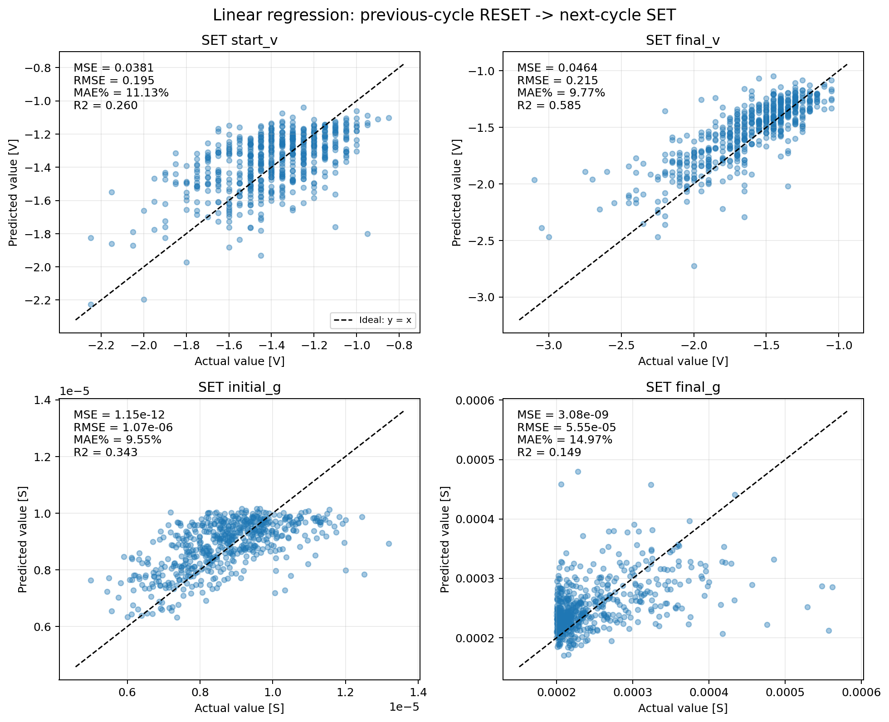
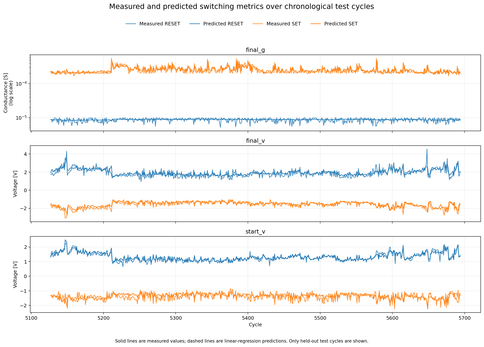
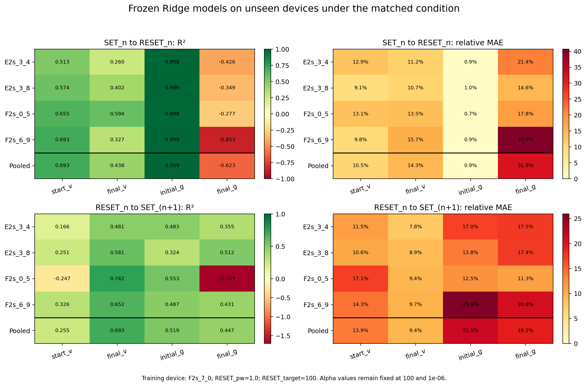

# MemristorML

MemristorML investigates whether measurements from one memristor switching
operation can predict the measurements of the operation that physically
follows it. The repository contains interpretable multi-output linear and
Ridge-regression baselines, data-pairing audits, evaluation scripts, and the
project documentation.

> **Research prototype:** the raw experimental datasets are not distributed in
> this repository. The code and documented results can be inspected publicly,
> but rerunning the experiments requires access to data with the schema
> described in [data/README.md](data/README.md).



## 30-second overview

A memristor switches between resistance states through alternating SET and
RESET operations. Although SET and RESET values share a row in this dataset,
the physical sequence is

```text
SET_n  ->  RESET_n  ->  SET_(n+1)  ->  RESET_(n+1)
```

The project evaluates two prediction tasks. Both predict the next physical
operation; the change from `n` to `n+1` comes from the dataset's cycle naming.

| Task | Mapping | Question |
|---|---|---|
| SET-to-RESET | `SET_n -> RESET_n` | Can SET measurements predict the RESET operation that follows them? |
| RESET-to-SET | `RESET_n -> SET_(n+1)` | Can RESET measurements predict the SET operation that follows them? |

Each input and target contains four quantities:

| Feature | Meaning | Unit |
|---|---|---|
| `start_v` | voltage at the start of the operation | V |
| `final_v` | voltage at the end of the operation | V |
| `initial_g` | conductance at the start of the operation | S |
| `final_g` | conductance at the end of the operation | S |

## Methodology

- Invalid rows are removed only when a selected feature, target, or relevant
  `has_error` flag is invalid.
- The main evaluation uses a chronological 80/10/10 train/validation/test
  split, so later cycles are not used to train a model evaluated on earlier
  cycles.
- `StandardScaler` is fitted only on the training inputs. Targets remain in
  their original physical units.
- `LinearRegression` and `Ridge` are fitted as four-output regression models.
- Ridge `alpha` is selected on the validation set only, by the mean validation
  R-squared value across the four targets.
- RESET-to-SET pairs are built within each device and experimental-condition
  group, and every retained target cycle is verified to equal its input cycle
  plus one.
- MAE, MSE, RMSE, relative MAE, and R-squared are reported separately for each
  target. Relative MAE is `100 * MAE / mean(abs(y_true))`; it is not MAPE.

## Main observations

- Linear predictability is strongly target-dependent.
- For `SET_n -> RESET_n`, `start_v` and `final_v` contain useful linear signal.
- The almost perfect `initial_g` score in the SET-to-RESET task is largely
  explained by physical continuity between SET `final_g` and RESET
  `initial_g`; it should not be interpreted as the model learning a difficult
  independent relation.
- For `RESET_n -> SET_(n+1)`, the strongest chronological linear result is for
  `final_v` (test R-squared approximately 0.585).
- Ridge regularization produces almost the same test results as ordinary
  linear regression for these experiments.
- Evaluation on devices excluded from training is supported, but those results
  are more sensitive to experimental conditions and distribution shift than
  the single-device results.

## Selected results

The cycle-series view compares measured values (solid lines) with predictions
on held-out chronological test cycles (dashed lines):



The external-device view reports frozen-model performance for devices excluded
from training under the matched experimental condition. Per-device rows are
shown together with the pooled result because pooled scores alone can hide
important variation between devices:



## Repository guide

```text
.
├── main.py                         # SET_n -> RESET_n baseline and split comparison
├── reset_to_next_set.py            # RESET_n -> SET_(n+1) baseline
├── ridge_regression.py             # Linear-versus-Ridge experiments
├── audit_reset_to_next_set.py      # Independent pairing and split audit
├── test_external_devices.py        # Frozen-model evaluation on another parquet file
├── show_parameter_matrices.py      # 5 x 4 augmented parameter matrices
├── plot_*.py                       # Reproducible figure-generation scripts
├── requirements.txt                # Core numerical and ML dependencies
├── requirements-plot.txt           # Core dependencies plus Matplotlib
├── tests/                           # Synthetic tests; no private data required
├── data/README.md                  # Required private-data schema and placement
└── docs/
    ├── project_log.tex             # Project documentation and work log
    ├── figures/                    # Curated generated figures
    └── results/README.md           # Generated-results reference
```

The filenames reflect the project's development history. In particular,
`test_external_devices.py` is an evaluation command-line script rather than a
unit-test module.

## Quick start

The project was developed with Python 3.9.

```bash
python3 -m venv .venv
source .venv/bin/activate
python -m pip install --upgrade pip
python -m pip install -r requirements-plot.txt
```

Place the authorised source dataset at:

```text
MemristorML/F2s_7_0.parquet
```

Then run the two baseline tasks:

```bash
python main.py
python reset_to_next_set.py
```

## Reproducing the analyses

| Command | Purpose | Main output |
|---|---|---|
| `python main.py` | chronological and random SET-to-RESET baselines | metrics printed to the terminal |
| `python reset_to_next_set.py` | chronological RESET-to-SET baseline | metrics printed to the terminal |
| `python audit_reset_to_next_set.py` | independent row-by-row pairing audit | pass/fail diagnostics |
| `python ridge_regression.py` | select Ridge alpha and compare with linear regression | CSV files under `docs/results/` |
| `python show_parameter_matrices.py` | recover parameter matrices in standardized and physical input coordinates | CSV files under `docs/results/` |
| `python plot_same_cycle.py` | SET-to-RESET figures | PNG files under `docs/figures/` |
| `python plot_reset_to_next_set.py` | RESET-to-SET figures | PNG files under `docs/figures/` |
| `python plot_cycle_series_predictions.py` | measured and predicted values across test cycles | PNG under `docs/figures/` |
| `python plot_ridge_comparison.py` | linear-versus-Ridge comparison | PNG under `docs/figures/` |

The pairing logic can be checked without access to the experimental data:

```bash
python -m unittest discover -s tests -v
```

External-device evaluation requires a second authorised dataset with the same
schema:

```bash
python test_external_devices.py /path/to/switching_summary_clean.parquet
python plot_external_device_test.py /path/to/switching_summary_clean.parquet
```

The models and scalers are fitted only on the source dataset before the unseen
devices are evaluated. The source device is excluded from every external
metric.

## Data availability

No raw Parquet file is committed to Git. See [data/README.md](data/README.md)
for the required MultiIndex, columns, validation rules, and expected local
filename. Do not publish or redistribute experimental data without permission
from its owner.

Because the raw data are private, this repository should currently be treated
as **code plus documented results**, not as a fully self-contained
reproducibility package.

## Documentation

- [Project documentation and work log](docs/project_log.tex)
- [Figure directory](docs/figures/)
- [Generated-results reference](docs/results/README.md)

The LaTeX source preserves the detailed mathematical derivations, validation
tables, experiment decisions, and work log developed during the project.

## Limitations

- The primary models are trained on one device and one experimental condition.
- The models are linear and may miss nonlinear switching behaviour.
- Performance depends strongly on the predicted target.
- Pooled external metrics can hide poor performance on individual devices.
- External inputs can fall outside the source training range.
- The raw dataset is not publicly distributed.

## License and citation

A public software/data license has not yet been assigned. Reuse and
redistribution therefore require permission from the relevant copyright and
data owners. Citation metadata should be added after the project title,
authorship, and publication status are agreed with the supervisor.
